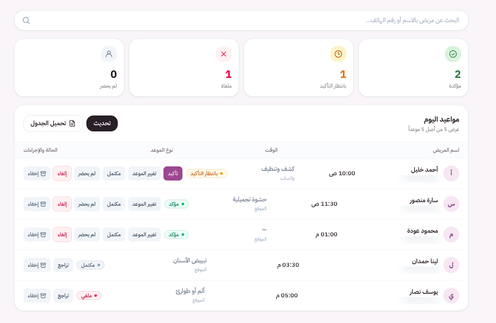
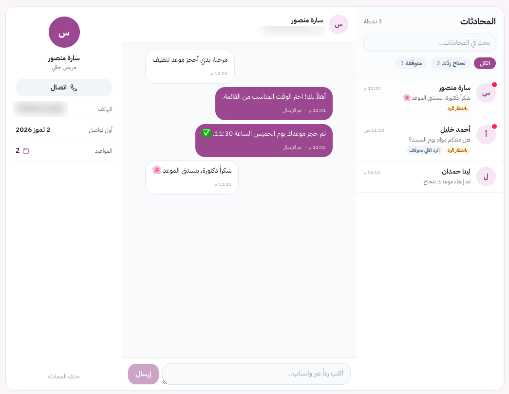
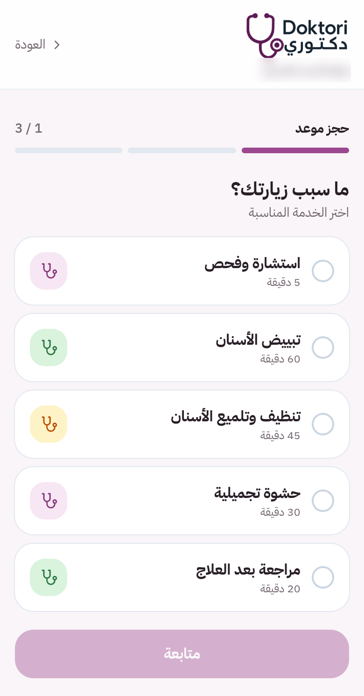
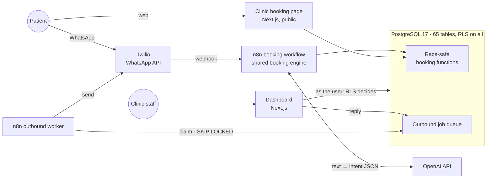

# Doktori · دكتوري — case study

**A WhatsApp-first booking and practice platform for dental clinics. Multi-tenant, Arabic right-to-left,
designed, built and operated by one developer.**

`Next.js 16` · `TypeScript` · `Tailwind CSS v4` · `PostgreSQL 17 / Supabase` · `Row-Level Security` · `n8n (self-hosted)` · `Twilio WhatsApp` · `OpenAI API` · `Vercel`

> The product code is proprietary and private. This repository explains the problem, the architecture
> and the engineering decisions, with small snippets written fresh for illustration.

<b>Kurzfassung auf Deutsch</b>

Doktori ist eine mandantenfähige SaaS-Plattform für Zahnarztpraxen: Patienten buchen per WhatsApp-Bot oder
über die eigene Buchungsseite der Praxis, das Team arbeitet in einem arabischen (RTL) Dashboard mit
Kalender, Patientenakte, Zahnbefund und Abrechnung. Pilotbetrieb mit einer Zahnarztpraxis. Technisch:
65 Tabellen, alle unter Row-Level Security, 114 Migrationen, eine asynchrone Job-Queue mit
`FOR UPDATE SKIP LOCKED` für ausgehende Nachrichten, ein WhatsApp-Bot über Twilio und selbst gehostetes n8n,
in dem die OpenAI API frei formulierte Buchungsnachrichten auswertet, und ein Append-only-Datenmodell für
Zahnbefund, Behandlungsnotizen und Einwilligungen.

## At a glance

| | |
|---|---|
| **What** | Online booking and a light practice system for dental clinics: WhatsApp bot, a public booking page per clinic, calendar, conversations, patient files, dental chart, payments. |
| **Status** | Pilot with a dental practice; deployed from Git, monitored and fixed in production. |
| **My role** | Everything: product, data model, booking engine, automation, UI, deployments, support. |
| **Since** | March 2026 |
| **Database** | PostgreSQL 17 · **65 tables, all under row-level security** · **114 migrations** |

## Screenshots

*Demo data. Phone numbers and the clinic's name are blurred. Screens from July 2026: the dental chart,
patient files and payments were added later.*

| | |
|---|---|
|  |  |
| **Today:** confirm, reschedule, complete or mark a no-show in one click. | **Conversations:** the WhatsApp thread with a patient. The doctor's reply goes back over the patient's channel. |

 
<b>Public booking page</b> of a clinic, step 1 of 3, on a phone.

## The problem

In Palestine, patients reach their dentist on WhatsApp. A small clinic answers booking requests by hand,
between treatments, and keeps the calendar on paper or in a phone. Messages get lost, slots get double-booked,
and treatment history sits in folders.

Doktori lets patients book in the place they already are, WhatsApp, or on the clinic's own booking page,
and gives the clinic one calm Arabic dashboard for the day.

**Users:** clinic staff and dentists (non-technical, Arabic, mostly on phones), their patients, and me as
the operator who sets up each clinic.

## Architecture

## Engineering decisions

### 1. One database, many clinics, isolation by row-level security

All 65 tables are under row-level security. Staff only ever see the clinics they belong to, and within a
clinic, per-member permissions (patients, clinical, finance) are checked **in the policies**, not only in the
UI. Anonymous visitors can read only what a public booking page needs, and can book only through the
booking functions. Each clinic's booking page is its own face: patients see the clinic, not a platform.

### 2. Every booking goes through one race-safe path

Web, WhatsApp and staff all create appointments through the same database function. Two patients tapping
the same slot at the same second cannot both get it: a per-doctor lock serialises the attempts, and an
exclusion constraint on the time range is the final guarantee. A trigger rejects an appointment that points
at another clinic's doctor or service.
→ [`snippets/02-no-double-booking.sql`](snippets/02-no-double-booking.sql)

### 3. One booking engine, several channels

The conversation (*reason → time → name → confirm*) is a single state machine in TypeScript with unit tests.
The WhatsApp workflow in n8n runs code **generated from that same source**, and a Telegram test channel runs
it too, so testing does not need WhatsApp approval. Interactive buttons fall back to a numbered list when a
channel cannot show them.

### 4. The language model reads, the code decides

Patients write freely: "بدي موعد بكرا الصبح" ("I want an appointment tomorrow morning"). The OpenAI API turns a
message like that into a small JSON intent, which the code validates. Availability, slots and the booking
itself stay with deterministic code and the database. If the answer cannot be parsed or is unsure, the bot
asks the patient to clarify instead of guessing; if the model is unreachable, the bot keeps working with its menu.
→ [`snippets/04-booking-engine.ts`](snippets/04-booking-engine.ts)

### 5. Outgoing messages through a queue

Replies from the dashboard and other outgoing messages are rows in a job table. Workers claim jobs with
`FOR UPDATE SKIP LOCKED`, so several workers never send the same message twice, and a crashed worker's job
becomes visible again after a timeout. Failures are retried with backoff and recorded.
→ [`snippets/01-job-queue-skip-locked.sql`](snippets/01-job-queue-skip-locked.sql)

### 6. Clinical records are append-only

Dental chart entries, treatment notes and consents are never overwritten. A correction is a new row that
points at the one it replaces, so the history of what was recorded, and when, stays intact.
→ [`snippets/03-append-only-clinical-notes.sql`](snippets/03-append-only-clinical-notes.sql)

### 7. Details that matter clinically

- **Teeth are stored in FDI notation** (11–48, milk teeth 51–85). The chart is drawn left-to-right inside the
  right-to-left page on purpose: the patient's right side appears on the screen's left, as dentists read it.
  Mirroring it with the page would label the wrong tooth.
- **A phone number is not a person.** A mother books for her children from one number, so a patient is
  identified by clinic, normalised phone *and* normalised Arabic name.
- **Money** is stored per row with its currency (₪, JD, $, €). Balances are always computed, never stored.

## Lessons

1. **Let the database hold the invariants.** No double booking, no cross-clinic references, no edited
   clinical history: each is enforced by a constraint or a trigger, not by hoping every code path is careful.
2. **Use the model for language, not for decisions.** Structured output plus validation makes the bot
   predictable. When it is unsure, the patient gets a question back, not a wrong appointment.
3. **Arabic text needs its own normalisation.** Names are written with and without hamza, ة or ه, diacritics.
   And in Postgres regular expressions `\d` can match Arabic-Indic digits, so phone normalisation uses `[0-9]`.
4. **One engine, many channels** made the WhatsApp bot testable without WhatsApp.
5. **Verify on the real screen.** Type checks and builds pass on bugs that only show at runtime, so every UI
   change is checked in the browser at phone width (360 px) before it ships.

## Snippets

Small, generic examples written for this case study. They are not taken from the product code.

| File | Shows |
|---|---|
| [`01-job-queue-skip-locked.sql`](snippets/01-job-queue-skip-locked.sql) | Job queue with `FOR UPDATE SKIP LOCKED`, visibility timeout and retries |
| [`02-no-double-booking.sql`](snippets/02-no-double-booking.sql) | Advisory lock plus an exclusion constraint against double booking |
| [`03-append-only-clinical-notes.sql`](snippets/03-append-only-clinical-notes.sql) | Corrections as new rows, history that cannot be edited |
| [`04-booking-engine.ts`](snippets/04-booking-engine.ts) | Channel-independent state machine; an LLM only turns text into a validated intent |

---

Mazen Abdallah · Wirtschaftsinformatik (B.Sc.) student at HTW Berlin ·
[LinkedIn](https://www.linkedin.com/in/mazen8abdallah) · [GitHub](https://github.com/mazendrop)
